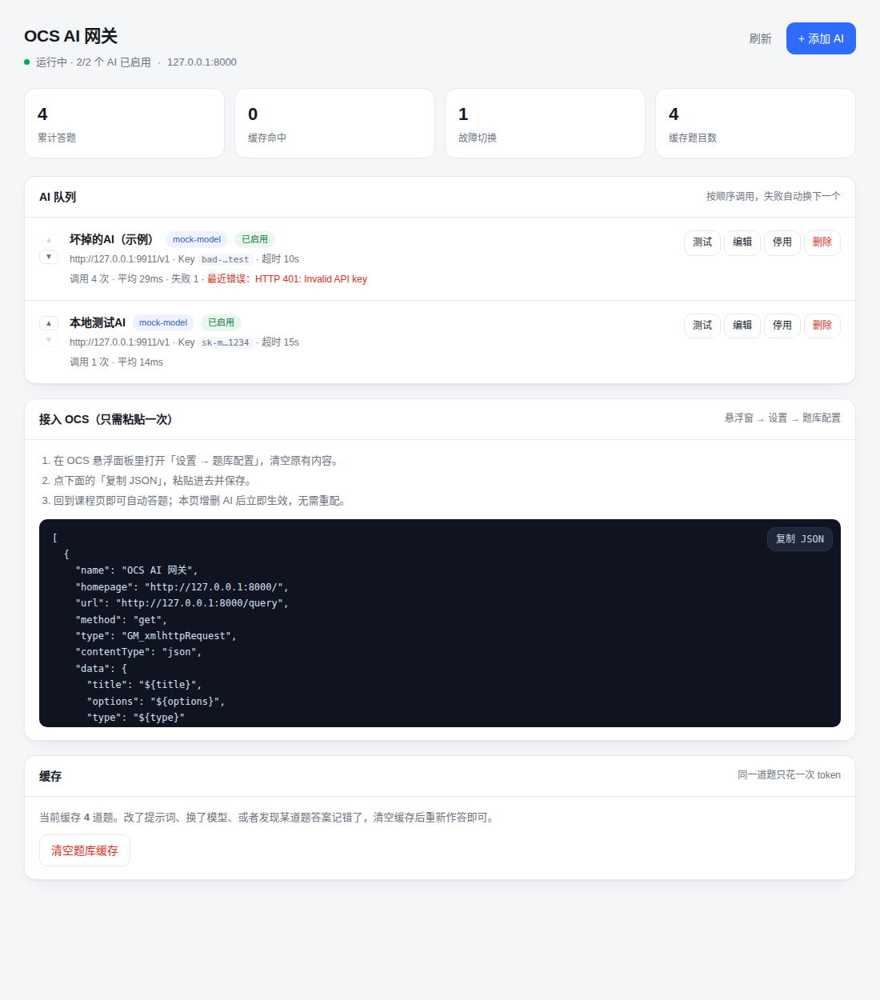

# OCS AI 网关

给 [OCS 网课助手](https://github.com/ocsjs) 用的本地 AI 题库服务。


比原版 `ocsjs-knowledge-ext` 多做四件事：

- **多个 AI 排队用**：按顺序调用，前一个超时 / 报错 / 答案解析不出来，自动换下一个
- **网页管理台**：在浏览器里增删 AI、填 Key、调顺序、点一下测试连通，不用改 `.env`、不用重启
- **答案缓存**：同一道题只花一次 token，重复刷到秒答
- **Key 只在本机**：全部存在 `data/providers.json`，不经过任何第三方

对外暴露的接口和 OCS 的 `AnswererWrapper` 完全兼容，OCS 那边配置一次就行。



---

## 一、快速开始

### 1. 准备 uv（二选一）

**方式 A：绿色便携（推荐，整个文件夹拷走就能用）**

去 [uv releases](https://github.com/astral-sh/uv/releases/latest) 下载 `uv-x86_64-pc-windows-msvc.zip`，解压出 `uv.exe`，放到本项目根目录，和 `启动网关.bat` 放在一起：

```
ocs-ai-gateway\
├── uv.exe          ← 放这里
├── 启动网关.bat
└── main.py
```

脚本会优先使用它，找不到才会去系统里找。ARM 版 Windows 请下 `uv-aarch64-pc-windows-msvc.zip`。

**方式 B：安装到系统（一次性）**

在 PowerShell 执行，装完关掉终端重开：

```powershell
powershell -ExecutionPolicy ByPass -c "irm https://astral.sh/uv/install.ps1 | iex"
```

两种方式都会被自动识别，不需要改脚本。

### 2. 双击 `启动网关.bat`

首次运行会自动装依赖（几分钟），然后：

- 窗口里出现 `Uvicorn running on http://127.0.0.1:8000`
- 浏览器自动打开管理台 <http://127.0.0.1:8000/admin>
- 点右上角 **「+ 添加 AI」**，填四项：

| 字段 | 填什么 |
|---|---|
| 名称 | 随便，比如 `DeepSeek` |
| Base URL | `https://api.deepseek.com/v1`（一般以 `/v1` 结尾） |
| 模型名称 | `deepseek-chat` |
| API Key | `sk-...` |

保存后点该条目的 **「测试」**，出现「✅ 连通正常」就说明能答题了。

### 3. 接到 OCS 上

管理台下方有 **「接入 OCS」** 区块，点「复制 JSON」，然后：

1. 打开 OCS 桌面端启动的浏览器，点悬浮面板 → **设置 → 题库配置**
2. 清空原有内容，粘贴，保存

之后回到课程页就会自动答题。本页增删 AI 立即生效，**不需要再动 OCS 配置**。

> 以后每次使用：双击 `启动网关.bat` → 等窗口起来 → 开 OCS 答题。想单独打开管理台就双击 `管理AI.bat`。

---

## 二、管理台能做什么

| 操作 | 说明 |
|---|---|
| 添加 / 编辑 | Key 编辑时留空表示不修改，不会把已有 Key 清掉 |
| 上移 / 下移 | 决定调用顺序，上面的先用 |
| 停用 / 启用 | 临时下线某个 AI，不用删 |
| 测试 | 用一道真题（"中国首都是？"）实打实调一次，返回答案和耗时 |
| 清空缓存 | 换模型或发现某题答案记错了，清掉重答 |

页面每 15 秒自动刷新统计数据：累计答题、缓存命中、故障切换次数、每个 AI 的调用次数与最近错误。

---

## 三、支持的题型

| 题型 | OCS 的 `type` 写法 | 返回格式 |
|---|---|---|
| 单选 | `single` | `A` |
| 多选 | `multiple` | `A#C`（`#` 分隔、字母升序） |
| 判断 | `judge` / `judgement` / `tf` / `truefalse` | `正确` 或 `错误` |

填空、简答等题型**不支持**，会返回 `code: 40002`，OCS 会跳过。

答案解析做了容错：模型返回 `{"answer":"B"}`、`答案：B。`、`B. 上海`、甚至直接抄选项原文，都能落到正确字母上。解析不出来就当作失败，自动换下一个 AI，**不会瞎填**。

---

## 四、配置项（`.env`）

| 变量 | 默认 | 说明 |
|---|---|---|
| `HOST` | `127.0.0.1` | 只允许本机访问；要给手机用改成 `0.0.0.0` |
| `PORT` | `8000` | 端口，改了要同步改 OCS 配置里的地址 |
| `GATEWAY_TOKEN` | 空 | 管理口令，暴露到局域网时**务必设置** |
| `CACHE_TTL_HOURS` | `168` | 缓存有效期，`0` 表示永久 |
| `REQUEST_TIMEOUT_SECONDS` | `30` | 单个 AI 的整体预算，超时即切换 |

首次运行时，如果 `data/providers.json` 不存在且 `.env` 里填了 `OPEN_AI_API_KEY`，会自动导入成第一个 AI（方便从旧版迁移）。

设置了 `GATEWAY_TOKEN` 时，管理台首次打开会要求输入口令并记在浏览器里；管理台复制的 JSON 会自动带上 `token` 字段。

---

## 五、目录结构

```
ocs-ai-gateway/
├── main.py                 启动入口
├── app/
│   ├── main.py             路由：/query、/admin、/api/*
│   ├── llm.py              调用 OpenAI 兼容接口（chat_completions / responses）
│   ├── parsing.py          题型归一化、提示词、答案解析
│   ├── store.py            多 AI 配置存储
│   ├── cache.py            答案缓存（sqlite）
│   └── static/admin.html   管理台页面
├── data/                   运行时生成：providers.json、answers.db
├── tests/test_gateway.py   15 个测试
├── 启动网关.bat
└── 管理AI.bat
```

## 六、开发与自测

```bash
uv sync
uv run python -m unittest discover -s tests -v
uv run fastapi dev main.py      # 带热重载的开发模式
```

`/docs` 有自动生成的接口文档，可以手动调 `GET /query` 验证。

---

## 七、常见问题

**Q：OCS 报 `Failed to fetch`？**
配置里 `"type"` 必须是 `GM_xmlhttpRequest`。网课页面是 https，用 `fetch` 请求 http 会被浏览器当混合内容拦掉。

**Q：管理台能打开，但答题一直失败？**
先点该 AI 的「测试」。测试失败会直接告诉你原因（401 Key 错 / 404 模型名错 / 超时）。

**Q：一直卡着不答？**
看黑窗口的日志。没日志 = 请求没到网关，检查 OCS 里填的地址和端口；有日志但报错，按提示改。

**Q：多开浏览器一起答题会不会冲突？**
不会，服务是异步的，多个请求并行。但同一道题并发时可能重复调一次模型（缓存写入有毫秒级竞争），影响很小。

**Q：怎么换端口？**
改 `.env` 里的 `PORT`，同步改 OCS 配置里的两处地址（`homepage` 和 `url`），重启网关。

---

## 八、和 `ocsjs-knowledge-ext` 的关系

本项目的思路来自 [quynj/ocsjs-knowledge-ext](https://github.com/quynj/ocsjs-knowledge-ext)（同样是 AnswererWrapper 兼容的单模型转发服务），在此基础上的差异：

| 能力 | knowledge-ext | 本项目 |
|---|---|---|
| 配置方式 | 改 `.env` 后重启 | 网页管理台，改完立即生效 |
| 模型数量 | 单一模型 | 多个 AI 排队 + 故障自动切换 |
| 连通性检查 | 需要手动 curl | 页面点「测试」按钮 |
| 答案缓存 | 无 | sqlite 本地缓存，同题秒答 |
| 管理鉴权 | 无 | 可选 `GATEWAY_TOKEN` |
| 返回值 | `code/data` | 完全兼容，额外带 `provider` / `cached` / `elapsed_ms` |

两者接口相同，可以互相替换，但**不能同时占用 8000 端口**。

---

## 九、开发与贡献

```bash
uv sync
uv run python -m unittest discover -s tests -v   # 15 个测试
uv run fastapi dev main.py                       # 热重载开发
```

提交前请确保 `uv run python -m unittest discover -s tests -v` 全绿。新增题型时同步更新 `app/parsing.py` 的归一化表、提示词、解析器和测试。

---

## 十、免责声明

本工具仅供个人学习与技术研究使用。使用者应自行确认使用方式符合所在课程与平台的规定，并承担由此产生的一切后果。AI 生成的答案可能有误，请勿用于正式考试或需要准确性的场景。

---

## 十一、License

[MIT](LICENSE)

